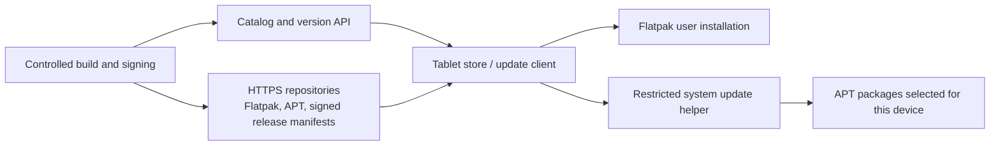

# Rebuilding JingOS Application and Update Services

[Home](../README.md) · [Software installation](software-management.md) · [Development](development.md) · [Kernel recovery](kernel-backport-2026-11-18.md)

## Status and scope

Updated: **2026-11-20**. This guide records the interfaces inspected on the JingPad C1 and a proposed procedure for replacing the discontinued vendor services. The self-hosted servers, repositories, replacement clients, and update workflow have **not been implemented or tested**. The build and publication commands below are future examples.

The target is JingOS 1.2.0 / Ubuntu 20.04 focal on ARM64, with glibc 2.31, Qt 5.15.2, libhybris, and the accepted vendor 4.14 kernel backports. See [device status](device-status.md) and [kernel acceptance](kernel-backport-2026-11-18.md) for their verification scope.

Start with application distribution and an inert test package. System components and boot updates require additional compatibility and recovery work. Replacing a server does not recreate the unavailable vendor package archive or provide ongoing security maintenance.

## What the existing clients actually use

These observations came from installed package metadata, QML, binary strings, and linked libraries. Embedded URLs establish the client defaults; configuration overrides, complete API schemas, and current server availability were not established by this inspection.

| Component | Observed implementation |
| --- | --- |
| Original App Store | JingOS fork of `plasma-discover`, version `5.20.5+p20.04+git20220115.10302-0`; only `packagekit-backend` loaded |
| Application catalog | Embedded base URL `https://appapi.jingos.com/v1/` and app details endpoint `https://appapi.jingos.com/v1/appinfo` |
| Update checker | `upgradebackend` supplies `/usr/bin/ub`, `updatordaemon.service`, and `org.jingos.info.checkcycle.service` |
| System settings | `kcm_mobile_info.so` and `/usr/share/kpackage/kcms/kcm_mobile_info/contents/ui/SystemUpdate.qml` |
| Version check | Embedded URL `https://om.jingos.com/api/v1/ota/versioncheck` |
| Update action | QML calls `UpdateTool.launchDistUpgrade(...)`; the plugin references `qaptupdator -s` |
| Package installation | `qaptupdator` links to `libQApt.so.3` and `libapt-pkg.so.6.0` and imports `updateCache`, `upgradeSystem`, and `commitChanges` |
| Configured APT sources | Original `ubuntu-ports.jingos.com` and `archive-mirrors.jingos.com` focal/vendor repositories |

The “OTA” version-check URL is part of a workflow that delegates installation to QApt/APT. A working version response alone does not establish that a system upgrade is safe or that whole-image OTA rollback exists.

Bazaar 0.10.0, Flathub access, ARM64 catalog search, and the Bazaar/Calculator home screen launchers have been verified separately. Bazaar's ability to browse and install from a new custom remote still needs testing. The installed Discover Flatpak-backend package contained documentation without a backend plugin; enabling Flatpak in that original UI would require additional client work.

## Replacement layout

Keep metadata, artifact publication, and privileged installation separate:



- The API supplies catalog entries, release notes, channel selection, and release references. It must not supply arbitrary shell commands for the tablet to execute.
- Flatpak and APT verify their repository signatures. A replacement system updater must also validate its release policy, target device, package selection, and any signed release manifest.
- A narrowly scoped privileged helper applies system changes under a defined local authorization policy. The web service does not receive an unrestricted root shell.
- Run the servers on a maintained Linux host outside the tablet. Signing keys belong in a protected operator environment or release job, outside the web root and Git.

Two frontend approaches are possible. Keeping the original App Store requires compatibility with its catalog requests and PackageKit/APT package identifiers. Using a Flatpak frontend requires testing custom-remote support or implementing that support. Do not assume a Flatpak repository can be substituted for an APT repository behind the unchanged original UI.

## 1. Preserve the baseline and recover the client contracts

Before migrating a client:

1. Record package versions, configured repositories and keys, Flatpak refs/commits, kernel build marker, and the working desktop layout. Use the [software-management backup procedure](software-management.md#back-up-configuration-and-package-inventories).
2. Inventory available original `.deb` files, source revisions, licenses, build inputs, and dependency closures. Installed files and firmware images do not constitute a complete reproducible package repository.
3. Locate the matching source for the Discover fork, settings module, `upgradebackend`, and `qaptupdator`. Record any differences from the installed versions before rebuilding against the old Qt/KDE ABI.
4. Recover the actual request methods, paths, headers, device/version fields, response schemas, error handling, and version-comparison rules. Keep redacted fixtures for catalog lists, app details, no-update, update-available, and failure responses.
5. Check for supported endpoint configuration. If none exists, add configurable service URLs to the client and rebuild it. Use our own HTTPS domain and trust configuration.

Inspect files and source without launching an update transaction. Opening the existing System Update page itself initiates version checking; do not call `launchDistUpgrade` or run `qaptupdator` as a discovery technique.

**Exit condition:** the client contracts and source/build requirements are documented, and an inert response fixture can be displayed without installing packages. Original client API compatibility remains unresolved until this work is completed.

## 2. Prepare hosting and trust

The examples use `packages.example.org`, `org.example.JingPadDemo`, and a placeholder key fingerprint. Replace them with controlled values. The examples assume one server Bash session, a dedicated release user with write access to `/srv/jingpad/public`, and the required packaging tools already installed.

Use an ARM64 builder compatible with the target runtime for applications. `--arch=aarch64` selects an architecture; it does not provide CPU emulation. Limit build concurrency and host resource usage; kernel builds must retain the [documented build limits](kernel-backport-2026-11-18.md#build-resources-and-boundaries).

```bash
set -eu
export JINGPAD_WORK="$HOME/jingpad-service-build"
export JINGPAD_PUBLIC="/srv/jingpad/public"
export JINGPAD_SIGNING_KEY="REPLACE_WITH_VERIFIED_FULL_FINGERPRINT"
mkdir -p "$JINGPAD_WORK/artifacts" "$JINGPAD_PUBLIC/keys"

# Requires an existing protected signing key and a usable GPG agent.
gpg --export "$JINGPAD_SIGNING_KEY" > "$JINGPAD_PUBLIC/keys/jingpad-repo.gpg"
test -s "$JINGPAD_PUBLIC/keys/jingpad-repo.gpg"
gpg --show-keys --with-fingerprint "$JINGPAD_PUBLIC/keys/jingpad-repo.gpg"
```

Record the full public-key fingerprint through a trusted channel before enrolling a tablet. HTTPS transport and a key downloaded from the same server do not independently establish that fingerprint. Production key separation, rotation, expiry, and recovery must be defined before unattended updates.

Expose clean repository artifacts over read-only HTTPS. Keep signing secrets, repository databases, build logs, private partitions, calibration data, and administrative write APIs outside the public tree. Publish immutable release snapshots; retain old payloads and signed metadata for recovery. Upload payloads before publishing indexes that reference them.

## 3. Build a signed Flatpak test repository

The server needs Flatpak, `flatpak-builder`, and GnuPG. Supply a real, validated ARM64 application manifest from its source project; this repository does not contain one. AppStream metadata, an icon, and a desktop entry are required for useful graphical discovery.

Configure and verify Flathub in the **builder release user's** installation. The tablet's remote configuration does not configure the builder:

```bash
flatpak remote-add --user --if-not-exists flathub \
  https://dl.flathub.org/repo/flathub.flatpakrepo
flatpak remotes --user --show-details
```

Read the manifest's runtime, SDK, versions, and SDK extensions, then verify their ARM64 refs in the configured repositories. For example, a manifest targeting GNOME 51 requires these builder-side metadata checks:

```bash
flatpak remote-info --user --arch=aarch64 flathub org.gnome.Platform/aarch64/51
flatpak remote-info --user --arch=aarch64 flathub org.gnome.Sdk/aarch64/51
```

Use the refs required by the actual manifest. If its dependencies come from another trusted remote, configure and verify that remote and adapt `--install-deps-from`.

Set `JINGPAD_APP_MANIFEST` to that manifest before running:

```bash
export JINGPAD_APP_ID="org.example.JingPadDemo"
export JINGPAD_FLATPAK_REPO="$JINGPAD_WORK/flatpak-testing"
JINGPAD_APP_BUILD="$(mktemp -d "$JINGPAD_WORK/flatpak-build.XXXXXX")"

flatpak-builder --user --arch=aarch64 --jobs=2 --force-clean \
  --install-deps-from=flathub \
  --gpg-sign="$JINGPAD_SIGNING_KEY" \
  --repo="$JINGPAD_FLATPAK_REPO" \
  "$JINGPAD_APP_BUILD" "$JINGPAD_APP_MANIFEST"

flatpak build-update-repo --gpg-sign="$JINGPAD_SIGNING_KEY" \
  "$JINGPAD_FLATPAK_REPO"
```

`--force-clean` applies only to the fresh temporary build directory created above. The build signs exported commits; `build-update-repo` signs repository summary metadata. Signing only the summary is insufficient. Publish this clean repository at `https://packages.example.org/flatpak/testing/` after checking its artifacts and public contents.

On the tablet, first install the independently verified public key at `/usr/share/keyrings/jingpad-repo.gpg` using a root shell. Preserve any existing file with that name. Then, in **`gao`'s graphical terminal**:

```bash
JINGPAD_APP_ID="org.example.JingPadDemo"
flatpak remote-add --user --if-not-exists \
  --gpg-import=/usr/share/keyrings/jingpad-repo.gpg \
  jingpad-testing https://packages.example.org/flatpak/testing/
flatpak remotes --user --show-details
flatpak remote-info --user --arch=aarch64 --show-metadata \
  jingpad-testing "$JINGPAD_APP_ID"
flatpak install --user --arch=aarch64 jingpad-testing "$JINGPAD_APP_ID"
flatpak run --user "$JINGPAD_APP_ID"
```

Inspect both app and runtime minimum client requirements before installation, following [architecture and version checks](software-management.md#check-architecture-and-minimum-versions-before-installation). An added remote with an existing name is not automatically corrected by `--if-not-exists`; verify its URL and signature policy.

**Exit condition:** a signed ARM64 app installs and runs from the custom repository; wrong signatures are rejected; catalog search, touch, and launch work in the chosen frontend. Verify the [home screen launcher integration](software-management.md#missing-home-screen-icons). Automatic integration for future installations is not yet configured on this device.

## 4. Build a signed APT test channel

Use a separate server build environment with `dpkg-deb`, `reprepro`, and GnuPG. The first package should be inert: no dependencies, maintainer scripts, services, or hardware changes.

```bash
export JINGPAD_DEMO_VERSION="0.1.0"
JINGPAD_DEMO_DIR="$(mktemp -d "$JINGPAD_WORK/deb-demo.XXXXXX")"
mkdir -p "$JINGPAD_DEMO_DIR/DEBIAN" \
  "$JINGPAD_DEMO_DIR/usr/share/doc/jingpad-update-demo"

cat > "$JINGPAD_DEMO_DIR/DEBIAN/control" <<EOF
Package: jingpad-update-demo
Version: $JINGPAD_DEMO_VERSION
Architecture: all
Maintainer: JingPad Maintainers <maintainer@example.org>
Section: misc
Priority: optional
Description: Inert package for testing the JingPad update channel
EOF
printf 'JingPad update channel test %s\n' "$JINGPAD_DEMO_VERSION" \
  > "$JINGPAD_DEMO_DIR/usr/share/doc/jingpad-update-demo/README"

# This inert demo contains no executable files or maintainer scripts.
find "$JINGPAD_DEMO_DIR" -type d -exec chmod 0755 {} +
find "$JINGPAD_DEMO_DIR" -type f -exec chmod 0644 {} +
JINGPAD_DEMO_DEB="$JINGPAD_WORK/artifacts/jingpad-update-demo_$JINGPAD_DEMO_VERSION"
JINGPAD_DEMO_DEB="$JINGPAD_DEMO_DEB""_all.deb"
dpkg-deb --root-owner-group --build "$JINGPAD_DEMO_DIR" "$JINGPAD_DEMO_DEB"
dpkg-deb --info "$JINGPAD_DEMO_DEB"
dpkg-deb --contents "$JINGPAD_DEMO_DEB"
sha256sum "$JINGPAD_DEMO_DEB"

export JINGPAD_APT_ROOT="$JINGPAD_WORK/apt-testing"
mkdir -p "$JINGPAD_APT_ROOT/conf"
cat > "$JINGPAD_APT_ROOT/conf/distributions" <<EOF
Origin: JingPad
Label: JingPad Testing
Suite: jingpad-testing
Codename: jingpad-testing
Architectures: arm64
Components: main
Description: Controlled JingPad test packages
SignWith: $JINGPAD_SIGNING_KEY
EOF

reprepro --basedir "$JINGPAD_APT_ROOT" includedeb jingpad-testing "$JINGPAD_DEMO_DEB"
reprepro --basedir "$JINGPAD_APT_ROOT" check
```

Check that archive directories, including `./`, have mode `0755` and the demo's files have mode `0644`. `--root-owner-group` normalizes ownership, not permissions. `Architecture: all` packages are included in the ARM64 index. Build actual native packages for Debian's `arm64` architecture and the focal userspace ABI; Flatpak calls this CPU architecture `aarch64`.

Stage only `dists/` and `pool/` from this repository for HTTPS publication at `https://packages.example.org/apt/testing/`. Check the signed Release metadata (`InRelease`, or `Release` plus `Release.gpg`) and index hashes. Preserve versioned snapshots and old `.deb` artifacts before publishing a replacement version; do not rely on the repository manager's default retention.

### Enroll the tablet and simulate installation

Back up APT configuration and installed package inventories first. Bootstrap `/usr/share/keyrings/jingpad-repo.gpg` from the verified public key. The following is a **tablet root Bash session** and uses isolated lists and only the test source; it does not require restoring the old vendor repositories:

```bash
cat > /etc/apt/sources.list.d/jingpad-testing.list <<'EOF'
deb [arch=arm64 signed-by=/usr/share/keyrings/jingpad-repo.gpg] https://packages.example.org/apt/testing/ jingpad-testing main
EOF

JINGPAD_TEST_APT="/var/lib/jingpad-maintenance/apt-testing"
install -d -m 0755 "$JINGPAD_TEST_APT/lists" "$JINGPAD_TEST_APT/archives"
install -d -o _apt -g root -m 0700 \
  "$JINGPAD_TEST_APT/lists/partial" "$JINGPAD_TEST_APT/archives/partial"

jingpad_apt() {
  jingpad_apt_binary="$1"
  shift
  "$jingpad_apt_binary" \
    -o Dir::Etc::sourcelist=/etc/apt/sources.list.d/jingpad-testing.list \
    -o Dir::Etc::sourceparts=- \
    -o "Dir::State::lists=$JINGPAD_TEST_APT/lists" \
    -o "Dir::Cache::archives=$JINGPAD_TEST_APT/archives" \
    "$@"
}

jingpad_apt apt-get update
jingpad_apt apt-cache policy jingpad-update-demo
jingpad_apt apt-get -s --no-remove install jingpad-update-demo=0.1.0
```

Preserve any pre-existing key or source file before replacing it. Inspect warnings and the complete simulated plan. For this demo, only the intended inert package should be installed. After reviewing that plan, in the **same root Bash session**:

```bash
jingpad_apt apt-get --no-remove install jingpad-update-demo=0.1.0
dpkg-query -W jingpad-update-demo
cat /usr/share/doc/jingpad-update-demo/README
```

Publish `0.1.1` by repeating the server build in a fresh package directory with the new version. Refresh the isolated indexes, simulate installing that exact version, then test the update and recovery to the retained previous version.

`--no-remove` does not prevent every unsuitable dependency upgrade. Real patches need a reviewed dependency closure and trusted same-release dependency sources; the isolated demo repository alone does not supply those dependencies.

**Exit condition:** the device verifies the repository signature, installs the demo, updates it, and recovers the previous version. A broken signature or unexpected package plan must prevent installation.

## 5. Implement the APIs and integrate the clients

First serve a small test catalog and version result. For a new client, use an explicitly versioned contract. The example below is a **proposed new format**, not the recovered JingOS API:

```json
{
  "schema_version": 1,
  "release_id": "demo-1",
  "device": "jingpad-c1",
  "architecture": "arm64",
  "base": "ubuntu-20.04-focal",
  "channel": "testing",
  "repository": "jingpad-testing",
  "snapshot": "2026-11-20-demo-1",
  "packages": [
    {
      "name": "jingpad-update-demo",
      "version": "0.1.0",
      "architecture": "all"
    }
  ],
  "reboot_required": false
}
```

Define the schema, version ordering, supported device IDs, channel enrollment, and downgrade rules before implementing installation. Repository names and snapshots must resolve through trusted client configuration. Sign immutable release-manifest bytes with a pinned release key and verify before parsing/applying them; define that signing and key-rotation contract as part of client implementation. The ordinary API can advertise a release reference, but cannot authorize arbitrary packages or commands by itself.

For the original UI, use the contracts recovered in step 1 and modify its endpoint configuration. Its current `launchDistUpgrade`/QApt system-upgrade path needs auditing or replacement with the controlled package plan. Changing the version-check URL while leaving an unrestricted upgrade action enabled is insufficient.

Test no-update, invalid manifest, unsupported device/architecture/base, wrong key, stale release, interrupted download, and duplicate retry cases before enabling the Install action. Display installation results and actionable errors in the UI. Verify custom-remote browsing and icon registration as part of the application-store path.

## 6. Expand to system patches, then kernel updates

Promote the same tested artifacts into a stable channel with retained signed snapshots. Keep candidate selection and installation reproducible; record source commits, build inputs, package hashes, installed versions, and acceptance results for each release.

Start with a small, independently recoverable userspace patch. Preserve the compatible JingOS Qt/KDE/libhybris, firmware, kernel configuration, and driver ABI. Do not switch Ubuntu releases or offer blanket `dist-upgrade`/`full-upgrade` through the replacement UI.

Maintain the host Flatpak/OSTree clients separately from app runtimes. The tested focal PPA versions do not establish a maintained security-update channel. Building and sustaining compatible ARM64 focal backports is part of the maintenance workload.

Boot/kernel updates are a later release class. Use the existing [kernel build, signing, readback, and physical recovery procedure](kernel-backport-2026-11-18.md#acceptance-and-recovery). Repository signing and boot-chain signing are distinct. Preserve the accepted boot components and verified rollback image; do not bypass boot verification to accept a candidate.

No automatic A/B or atomic root-filesystem OTA recovery has been validated in this project. A version manifest or signed package alone does not provide it.

## Acceptance and rollback

| Layer | Required acceptance | Recovery requirement |
| --- | --- | --- |
| API/client | Correct catalog/version display; incompatible or invalid releases rejected; retries do not duplicate changes | Restore known client/configuration and stop advertising the candidate |
| Flatpak | Signed ARM64 app installs, updates, opens from its icon, and passes required interaction tests | Retain previous app/runtime commits and app-data backups; a commit rollback does not revert data migrations |
| APT | Expected origins and exact versions; reviewed dependency plan; install/update and previous-version recovery tested | Retain signed snapshots, old packages and dependency closure, configuration, and data; restoring sources alone does not roll back packages |
| Boot/kernel | Original configuration/module ABI, signature, full readback, boot, display, touch, audio, and target interface checks | Original boot image and manifests, verified physical recovery access, and an available operator |

Keep release and rollback evidence outside Git when it contains device identifiers, personal logs, signing material, or raw partitions. Commit only sanitized manifests, public configuration, source patches, and reproducible build instructions.

The first milestone is complete only after one application and the inert APT package pass these checks through the replacement clients. A working HTTP endpoint or successful repository download is preparation, not end-to-end acceptance.

## References

- [Flatpak repository hosting](https://docs.flatpak.org/en/latest/hosting-a-repository.html)
- [Flatpak builder command reference](https://docs.flatpak.org/en/latest/flatpak-builder-command-reference.html)
- [Flatpak command reference](https://docs.flatpak.org/en/latest/flatpak-command-reference.html)
- [reprepro manual](https://manpages.debian.org/stable/reprepro/reprepro.1.en.html)
- [APT repository authentication](https://manpages.ubuntu.com/manpages/focal/en/man8/apt-secure.8.html)
- [JingOS source references and compatibility limits](development.md#source-code-and-reference-material)
